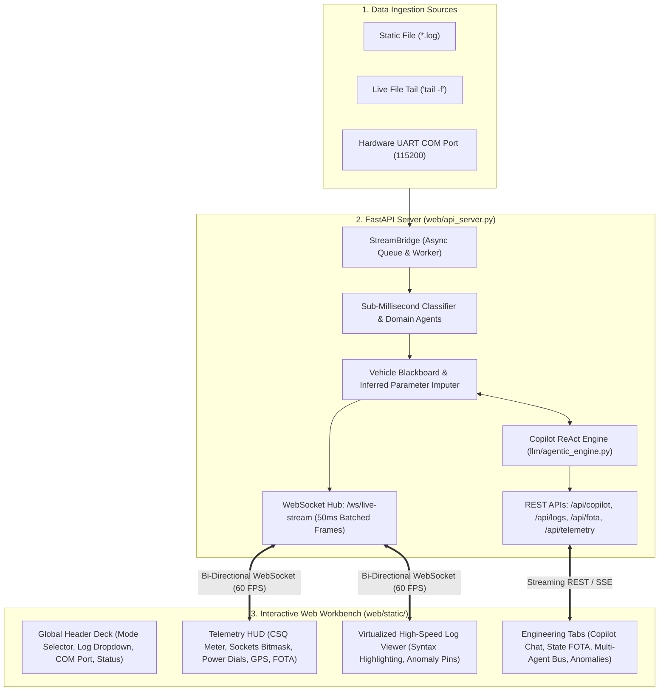

# FastAPI Interactive UI Workbench: Architecture & Implementation Plan

---

## 1. Executive Summary & Objective

The objective is to build a **production-grade, high-performance interactive Web Workbench** for the **Level 4 Autonomous Automotive Telemetry & Log Analyzer**, accurately implementing the design and features shown in [`interactive_ui_mockup.jpg`](file:///D:/AEPL_AUTOMATION/LOG_ANALYZER/interactive_ui_mockup.jpg).

### Core Capabilities Required:
1. **Multi-Mode Log Viewing & Streaming:**
   - Static file viewing with instant line jumping, syntax highlighting, and regex search.
   - Real-time live file tailing (`tail -f`) and physical hardware UART serial streaming (`COM3 @ 115200 baud`) with auto-scroll ("Follow Tail").
2. **Live Telemetry HUD (Interactive Gauges):**
   - 4G LTE signal widget (`CSQ 26/31`, `Airtel 4G`, `MQTT Connected` pulse LED).
   - TCP Sockets Bitmask matrix `[AIS CHTP CIP1]` with dynamic on-the-go synthesis indicator (`CIP1: Inferred Active`).
   - Power dual-dials (External Battery `24.1V` & Internal Li-ion `3.8V`).
   - GNSS Polar Satellite Radar (12 satellites, 3D Fix lock, live coordinates).
   - Indian State FOTA Migration Card (Target State `MH - Maharashtra`, 100% progress, migrated secondary IP `data.vahanshakti.in:4040`).
3. **Automotive Telemetry Copilot:**
   - Streaming conversational AI interface directly backed by [`AutomotiveDiagnosticAgent`](file:///D:/AEPL_AUTOMATION/LOG_ANALYZER/llm/agentic_engine.py).
   - Quick-action suggestion chips (*"Validate State FOTA"*, *"Audit CIP1 Status"*, *"Show 8 Logins"*, *"Explain CAN Timeout"*).
   - Clickable line citations that jump the Log Viewer directly to cited lines.
4. **Zero-Friction Deployment:**
   - Zero-build frontend (Native ES6 Modules + Tailwind CSS + Lucide Icons) requiring no complex Node.js/npm toolchains. Runs with a single Python command: `python main.py --mode web`.

---

## 2. System Architecture & Component Hierarchy



---

## 3. Directory Structure to be Created

We will create a clean, dedicated `web/` module inside the project without altering existing core engine logic:

```text
LOG_ANALYZER/
├── web/                                # New Interactive Web Workbench
│   ├── __init__.py
│   ├── api_server.py                   # FastAPI Application & Lifespan Controller
│   ├── stream_bridge.py                # Async Adapter for live_stream_reader & process_log
│   ├── ws_hub.py                       # WebSocket Connection Manager & Broadcast Hub
│   ├── routes/
│   │   ├── __init__.py
│   │   ├── telemetry.py                # REST endpoints: /api/blackboard, /api/telemetry
│   │   ├── copilot.py                  # REST endpoint: /api/copilot/query (Streaming)
│   │   ├── fota.py                     # REST endpoint: /api/fota/validate-state
│   │   └── logs.py                     # REST endpoints: /api/logs/list, /api/logs/upload
│   └── static/                         # High-Performance Frontend Assets
│       ├── index.html                  # Main Workbench Shell (matches mockup)
│       ├── css/
│       │   └── theme.css               # Dark Industrial Automotive Theme
│       └── js/
│           ├── app.js                  # Main Orchestrator & State Hub
│           ├── ws_client.js            # WebSocket Stream Consumer & Buffer
│           ├── components/
│           │   ├── log_viewer.js       # Virtualized Log Viewer with Anomaly Pins
│           │   ├── telemetry_hud.js    # CSQ, Sockets, Power, GNSS & FOTA Gauges
│           │   ├── copilot_chat.js     # AI Copilot Interface & Action Chips
│           │   ├── state_fota_tab.js   # Indian State FOTA 6-Step Handshake Timeline
│           │   └── anomaly_table.js    # Filterable Anomaly Explorer
```

---

## 4. API & WebSocket Specifications

### 4.1 WebSocket Stream Channel (`/ws/live-stream`)
* **Purpose:** High-throughput bi-directional streaming of parsed log lines, telemetry state updates, and detected anomalies.
* **Client $\rightarrow$ Server Commands:**
  ```json
  {"action": "start_tail", "log_file": "logs/FOTA_REL_18_To_REL_05.log"}
  {"action": "start_uart", "port": "COM3", "baud": 115200}
  {"action": "pause_stream"}
  {"action": "resume_stream"}
  {"action": "seek_line", "line_number": 125361}
  ```
* **Server $\rightarrow$ Client Broadcast (Batched every 50ms for 60 FPS):**
  ```json
  {
    "type": "TELEMETRY_BATCH",
    "data": {
      "lines": [
        {"num": 125361, "ts": "16:24:57.481", "tag": "FOT", "raw": "INFO: [FOT] tcp ota request : *SET#CIP1#data.vahanshakti.in#4040#"}
      ],
      "blackboard": {
        "ignition": "ON (1)",
        "csq": 26,
        "mqtt": 1,
        "tcp_skt_raw": "011",
        "tcp_cip1": 1,
        "ext_battery_v": "24.10V",
        "int_battery_v": "3.80V",
        "gps_sats": 12,
        "gps_fix": 1,
        "fota_pct": "100.00%",
        "inferred_parameters": {
          "tcp_cip1": {"value": 1, "confidence": 0.95, "status": "DYNAMICALLY_INFERRED"}
        }
      },
      "new_anomalies": []
    }
  }
  ```

### 4.2 REST Endpoints
| Method | Endpoint | Description |
| :--- | :--- | :--- |
| `GET` | `/api/logs/list` | Returns list of available logs in `logs/` directory with file sizes. |
| `POST` | `/api/logs/upload` | Upload custom `.log` file into `logs/` folder. |
| `GET` | `/api/serial/ports` | Auto-detects connected hardware COM ports using PySerial. |
| `GET` | `/api/blackboard/snapshot` | Returns current snapshot of all parameters (explicit & dynamically inferred). |
| `POST` | `/api/copilot/query` | Submits prompt to `AutomotiveDiagnosticAgent` with streaming response chunks. |
| `GET` | `/api/fota/validate-state` | Runs 4-phase audit on Indian State FOTA migration (Maharashtra endpoints). |
| `GET` | `/api/telemetry/audit-cip1` | Returns audit of CIP1 socket bit vs secondary server configuration. |
| `GET` | `/api/anomalies` | Returns list of all detected anomalies with start/end lines and severity. |

---

## 5. UI Features & Component Implementation Plan

### Component 1: Global Ingestion Control Deck (Header Bar)
* Ingestion Mode Selector tabs (`File Mode`, `Live Tail Mode`, `Live UART COM3 @ 115200`).
* Active Log File dropdown with search and file upload button.
* Hardware COM Port selector with `Connect / Disconnect` toggle button.
* Vehicle Ignition Status Pill (`● VEHICLE RUNNING IGN=1` in glowing emerald vs `● PARKED LOW-POWER SLEEP` in amber).
* Ingestion throughput meter (`1,420 lines/sec`) and total lines counter.

### Component 2: Telemetry HUD (Live Animated Gauges)
* **Cellular 4G LTE Card:** 5-bar signal strength meter (`CSQ 26/31`), operator pill (`Airtel 4G`), and pulsing green `MQTT Connected` LED.
* **TCP Sockets Bitmask Card:** Visual matrix for `[AIS CHTP CIP1]`. If `CIP1` was missing from the line but synthesized on the go, displays an amber badge: `CIP1: Inferred Active (95% Conf)`.
* **Power Dual-Dials:** Real-time analog SVG dials for External Battery (`24.1V`) and Internal Li-ion (`3.8V`).
* **GNSS Polar Constellation Radar:** Circular constellation radar plotting visible satellites (12 satellites, 3D Fix lock, latitude/longitude).
* **Indian State FOTA Card:** Target state (`MH - Maharashtra`), progress ring (`100%`), and migrated secondary server (`data.vahanshakti.in:4040`).

### Component 3: Virtualized High-Speed Log Viewer (Left Pane)
* DOM Virtualization rendering only visible rows (smooth 60 FPS scrolling across 200,000+ lines).
* Real-time syntax coloring for subsystem tags: `[NET]` (Cyan), `[CAN]` (Purple), `[FOT]` (Green), `[GPS]` (Yellow), `[SYS]` (Red).
* Gutter line numbers with clickable circular anomaly indicator pins (jumping directly to the diagnostic card).
* Instant regex search bar with live occurrence counter and Next/Prev navigation.
* "Follow Tail" mode toggle to automatically lock view to newest incoming frames.

### Component 4: Automotive Telemetry Copilot (Right Pane)
* Conversational AI chat view powered by Gemini ReAct via [`AutomotiveDiagnosticAgent`](file:///D:/AEPL_AUTOMATION/LOG_ANALYZER/llm/agentic_engine.py).
* Clickable Quick-Action Chips:
  - `[Validate State Migration]`
  - `[Audit CIP1 Status]`
  - `[Show 8 Login Handshakes]`
  - `[Explain CAN Timeout at Line 20]`
* Collapsible technical evidence drawers displaying cited raw log lines.
* Clickable line numbers inside Copilot messages that smoothly scroll the left Log Viewer to that exact line.

### Component 5: Tabbed Engineering Workbench
* **Tab 1: Copilot Chat** (Primary AI diagnostic assistant).
* **Tab 2: State FOTA Migration** (Visual 6-step post-flash handshake checklist from [`FOTA-Workflow.pdf`](file:///D:/AEPL_AUTOMATION/LOG_ANALYZER/FOTA-Workflow.pdf) + IP delta table).
* **Tab 3: Anomaly & Cascade Explorer** (Filterable table with severity badges, standby cascade indicators, and suggested firmware fixes).
* **Tab 4: Multi-Agent Blackboard Inspector** (Live table of raw vs dynamically inferred blackboard variables).

---

## 6. Implementation Phasing & Execution Strategy

| Phase | Tasks & Deliverables | Verification Milestone |
| :--- | :--- | :--- |
| **Phase 1: Backend Setup** | Implement `web/api_server.py`, `web/ws_hub.py`, and core REST endpoints (`logs`, `blackboard`, `serial`). | Backend starts on `http://localhost:8000` with passing health-check endpoint. |
| **Phase 2: Stream Ingestion Bridge** | Build `web/stream_bridge.py` connecting `live_stream_reader` (tail & UART) and static file processor to WebSocket hub. | Live frames stream over `/ws/live-stream` without dropping lines. |
| **Phase 3: Frontend Shell & Log Viewer** | Build `web/static/index.html`, `theme.css`, and virtualized `log_viewer.js` with syntax highlighting and search. | Log viewer smoothly renders 147k lines at 60 FPS with instant jump-to-line. |
| **Phase 4: Telemetry HUD Gauges** | Build `telemetry_hud.js` implementing CSQ meter, Sockets bitmask, Power dials, GNSS radar, and State FOTA card. | Gauges animate live in sync with incoming frames and blackboard state deltas. |
| **Phase 5: Copilot Chat Integration** | Implement `copilot_chat.js` and `web/routes/copilot.py` with streaming responses and quick-action chips. | Clicking action chips returns grounded AI analysis and highlights cited lines. |
| **Phase 6: State FOTA & Anomaly Tabs** | Implement `state_fota_tab.js` and `anomaly_table.js` matching [`FOTA-Workflow.pdf`](file:///D:/AEPL_AUTOMATION/LOG_ANALYZER/FOTA-Workflow.pdf). | 6-step post-flash handshake displays Pass/Fail verification for Maharashtra state. |
| **Phase 7: CLI Integration & Verification** | Add `--mode web --port 8000` to [`main.py`](file:///D:/AEPL_AUTOMATION/LOG_ANALYZER/main.py) and test end-to-end execution. | Single command `python main.py --mode web` launches full interactive workbench. |

---

## 7. Verification & Acceptance Criteria

1. **Visual Fidelity:** The web interface matches the dark industrial aesthetic, HUD cards, log viewer, and Copilot layout shown in [`interactive_ui_mockup.jpg`](file:///D:/AEPL_AUTOMATION/LOG_ANALYZER/interactive_ui_mockup.jpg).
2. **Performance:** Virtualized log viewer handles 100,000+ lines at 60 FPS with zero DOM freezing or memory leak.
3. **Live Streaming:** Both live file tailing (`--mode tail`) and hardware serial UART (`--mode uart`) stream frames continuously into the UI.
4. **Dynamic Parameter Synthesis:** When `CIP1` is missing or unset, the UI HUD updates with `CIP1: Inferred Active (95% Conf)` based on secondary server traffic.
5. **FOTA State Migration:** The State FOTA tab verifies Maharashtra state commands (`*SET#SWEMP#MH#` and `*SET#CIP1#data.vahanshakti.in#4040#`).
6. **No External Build Tools:** Operates cleanly in any standard modern web browser without requiring `npm install` or webpack build steps.
