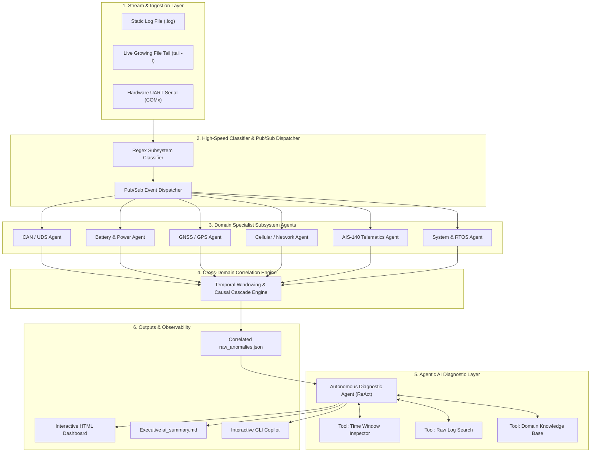

# 📘 Automotive Telematics & Embedded Firmware Knowledge Base

## 1. System Architecture & Multi-Domain Ingestion

The **LOG_ANALYZER** ingests high-volume telemetry traces from Automotive Telematics Control Units (TCUs), Vehicle Tracking Units (VTUs), and Electronic Control Units (ECUs). Telemetry data is parsed, classified, and analyzed across 6 core automotive subsystems:



---

## 2. Telemetry Syntax & Subsystem Specifications

The parser supports two industry-standard automotive embedded log formats:

### Format A: ATCU Snapshot NMEA-style Frames (`$TAG`)
Used during ECU bootup, periodic diagnostic heartbeats, and status queries:
- **GPS**: `$GPS,<msg_id>,<utc_time>,<fix_quality>,<latitude>,<longitude>,<sat_count>`
  - *Example*: `[2026-05-13 15:19:19.455] $GPS,1030,000000,0,0.000000,0.000000,0`
- **Battery**: `$ANALOG,<ext_batt>,<int_batt>,<tmpr>,<an1>,<an2>`
  - *Example*: `[2026-05-13 15:19:19.445] $ANALOG,23.98,3.76,25,0.00,23.94`
- **Cellular & MQTT**: `$GSM,<csq>,<creg>,<cgreg>,<tcp_skt>,<mqtt_count>,"<operator>",...`
  - *Example*: `[2026-05-13 15:19:19.455] $GSM,26,1,1,1,1,"Jio 4G",-,0,0`
- **CAN Bus**: `$CAN2,<bus_state>,<error_flag>`
  - *Example*: `[2026-05-13 15:19:19.471] $CAN2,0,0`

### Format B: Subsystem Execution Traces (`[PLA]`, `[CAN]`, `[AIS]`)
Generated dynamically during active firmware execution:
- **CAN / UDS**: `[CAN] UDS Session Timeout` | `DTC: 0xP0100`
- **Battery / Power**: `[PLA] ANALOG INT BATT 3.76V 55.58 PERCENT, TMPR 0, EXT BATT 23.98V, AN 0.00V`
- **GNSS / GPS**: `[PLA] GPS RX 322,DT 060180,TM 000841,LAT 0.000000,LONG 0.000000,FIX QUA 0,SAT 0`
- **Cellular / Network**: `[PLA] NET CSQ 26, CREG: 2, CGREG: 2, TCP SKT: 000, MQTT: 0, OPR NM:`
  - **`TCP SKT` Architecture (3-bit Socket Status Bitfield)**:
    ```text
    0 0 0
    | | |
    | | +----------- CIP1 (Customer IP 1 / Secondary Auxiliary Telemetry Socket)
    | +------------- CHTP (Commercial HTTP / Fleet Telematics Portal Socket)
    +--------------- AIS / Primary Socket (AIS-140 Government / Emergency Primary Socket)
    ```
    - `Bit 2 (Leftmost)`: **AIS / Primary Socket** — Regulatory AIS-140 emergency tracking server connection (`1` = Connected, `0` = Disconnected).
    - `Bit 1 (Middle)`: **CHTP** — Commercial HTTP/TCP telematics portal socket for enterprise fleet management (`1` = Connected, `0` = Disconnected).
    - `Bit 0 (Rightmost)`: **CIP1** — Customer IP 1 auxiliary socket for OEM telemetry forwarding (`1` = Connected, `0` = Disconnected).
    - **Common Bitmask States**:
      - `000`: All sockets closed (Modem unattached or in sleep)
      - `001`: Only CIP1 connected
      - `010`: Only CHTP connected
      - `011`: CHTP and CIP1 connected; AIS Primary disconnected
      - `100`: Only AIS Primary connected
      - `101`: AIS Primary and CIP1 connected; CHTP disconnected
      - `110`: AIS Primary and CHTP connected; CIP1 disconnected
      - `111`: All 3 sockets connected and operational
- **AIS-140**: `[AIS] Packet saved to history TxSeq=15 CTX=0 PktTyp=3` | `[AIS] PRI | EPB`
- **System / Power**: `[PLA] SLEEP 176...` | `[PLA] DIAG HEAP (5551624/12582912)` | `[PLA] DIGITAL IGN 0`

### Format C: Cellular Modem Transmission Traces (`[NET] GSM_TX`)
Transmitted directly over established TCP sockets between the TCU and backend servers:
- **Telematics Device Login & Handshake Packet (`55AA,1`)**:
  - *Example*: `[2026-05-29 15:28:07.152] INFO:  [NET] GSM_TX(247): |55AA,1,2,1719232527,861564061380138,89916420534724851291,ACON4NA072500050685,5.2.8,ACCDEV07241580138,UF,data.vahanshakti.in,4030,Device.vltsecurity.com,5478,1,55555,1108,649,511,0,0,0,55555,1108,649,511,0,0,0.000000,-,0.000000,-,24.1,3.8,1,C,0,1,0|`
  - *Trigger*: Sent by TCU immediately upon TCP socket connection establishment to register identity and negotiate communication with the server.
  - *Field Breakdown (23 Fields)*:
    1. `55AA`: Frame Synchronization Header (`0x55AA`)
    2. `1`: Packet Type (`1` = Device Registration & Login Handshake)
    3. `2`: Socket Descriptor / Channel (`Socket 2`)
    4. `1719232527`: UTC Epoch Timestamp (`2024-06-24 12:35:27`)
    5. `861564061380138`: TCU Cellular Modem IMEI (15 digits)
    6. `89916420534724851291`: SIM Card ICCID (20 digits)
    7. `ACON4NA072500050685`: Vehicle Identification Number (VIN) / Chassis ID
    8. `5.2.8`: Current Device Firmware Version
    9. `ACCDEV07241580138`: Hardware Serial Number & Model Code
    10. `UF`: Operating State / Firmware Mode
    11. `data.vahanshakti.in`: Primary Server Hostname (AIS-140 Vahan Backend)
    12. `4030`: Primary Server Port
    13. `Device.vltsecurity.com`: Secondary Server Hostname (Fleet Management Portal)
    14. `5478`: Secondary Server Port
    15. `1`: Connection / Roaming Mode
    16. `55555,1108,649,511,0,0,0`: Primary Calibration & Fuel Sensor Configuration
    17. `55555,1108,649,511,0,0`: Secondary Calibration Parameters
    18. `0.000000,-,0.000000,-`: GPS Latitude & Longitude
    19. `24.1`: External Battery Voltage (V)
    20. `3.8`: Internal Battery Voltage (V)
    21. `1`: Ignition Status (`IGN=1`)
    22. `C`: Telemetry Connection State
    23. `0,1,0`: Digital I/O & Socket Status (`AIS=0, CHTP=1, CIP1=0`)
- **Server Handshake & Download Negotiation Response (`55AA,1`)**:
  - *Example*: `[2026-05-29 15:28:07.845] 55AA,1,2,1780048490,5.2.11,1,0,0,1757192,0,1024,FF`
  - *Response Content*: Returns target firmware version (`5.2.11`), total firmware binary length (`1,757,192` bytes), and packet chunk size (`1024` bytes / 1 KB).

---

## 3. Subsystem Knowledge Rule Matrix & Anomaly IDs

| Subsystem | Anomaly ID | Condition | Severity | Root Cause & Diagnostic Remediation |
| :--- | :--- | :--- | :--- | :--- |
| **GPS** | `GPS_KN_001` | `SAT == 0 AND FIX == 0` | High | GNSS receiver lost satellite RF signals. Check antenna SMA connection, LNA supply rail (~3.3V), and sky visibility. |
| **GPS** | `GPS_KN_002` | `SAT >= 4 AND FIX == 0` | High | Satellites visible but 3D fix unacquired. Check GNSS ephemeris interval, HDOP dilution, and multipath reflections. |
| **GPS** | `GPS_KN_003` | `FIX == 1 AND (LAT==0 OR LONG==0)` | Medium | Zero coordinates reported with valid fix bit. Inspect NMEA parser buffer offset in firmware C-struct. |
| **GPS** | `GPS_KN_004` | `0 < SAT < 4` | Medium | Weak satellite reception (<4 satellites). Check sky visibility or vehicle underpass. |
| **BATTERY** | `BATT_KN_001` | `EXT_BATT < 9.0V` | High | Vehicle main battery disconnected or dropped below operational range. Inspect alternator and harness fuse. |
| **BATTERY** | `BATT_KN_002` | `INT_BATT < 3.4V OR SOC < 15%` | High | Internal backup Li-ion battery depleted. Inspect internal charger IC (e.g. BQ24xxx) or replace cell. |
| **BATTERY** | `BATT_KN_003` | `TMPR > 55°C` | High | Battery thermistor over-temperature. Verify enclosure heatsinking and thermal isolation from engine bay. |
| **BATTERY** | `BATT_KN_004` | `EXT_BATT < 7.5V (cranking)` | Medium | Engine starter cranking voltage sag. Ensure TCU meets ISO 16750-2 cold cranking pulse requirements. |
| **CAN** | `CAN_KN_001` | `UDS Session Timeout` | High | UDS diagnostic session timed out waiting for ECU response. Check ECU power state (IGN), CAN-H/L wiring, and termination. |
| **CAN** | `CAN_KN_002` | `DTC Code Active` | Critical | Diagnostic Trouble Code reported by vehicle ECU. Cross-reference code in OEM fault dictionary. |
| **CAN** | `CAN_KN_003` | `BUS_STATE == 2 (Bus-Off)` | Critical | CAN controller Tx Error Counter exceeded 255. Verify 60-ohm bus impedance and baud rate clock configuration. |
| **NET** | `NET_KN_001` | `CSQ < 10` | Medium | Poor cellular RF signal quality. Check LTE antenna placement and RF shielding. |
| **NET** | `NET_KN_002` | `CREG in [0, 2, 3]` | High | Mobile network registration failed or searching. Check SIM physical seating, APN, and carrier balance. |
| **NET** | `NET_KN_003` | `CGREG in [0, 2, 3]` | High | GPRS/LTE packet data unattached. Confirm APN profile and carrier PDP context activation. |
| **NET** | `NET_KN_004` | `MQTT == 0` | High | Telemetry MQTT broker disconnected. Check TLS certificate expiration, DNS resolution, and keepalive timer. |
| **NET** | `NET_KN_005` | `OPERATOR == ''` | Low | Modem did not receive Network Operator Identification. Check AT+COPS? modem response and SIM provisioning. |
| **NET** | `NET_KN_006` | `TCP_SKT == '000' AND IGN == 1` | High | All 3 telematics sockets (AIS, CHTP, CIP1) closed while vehicle running. Inspect DNS, APN quota, and server endpoints. |
| **NET** | `NET_KN_007` | `TCP_SKT[0] == '0' AND IGN == 1` | High | AIS-140 primary regulatory tracking socket disconnected while vehicle ignition is ON. Inspect AIS server IP/port. |
| **NET** | `NET_KN_008` | `Login Handshake Timeout` | High | Login packet (`55AA,1`) sent over TCP socket but backend server did not return ACK/response within timeout window. Inspect server port availability, firewall whitelist, and SIM APN. |
| **AIS** | `AIS_KN_001` | `EMR == 1 OR PktTyp == 2` | Critical | Vehicle SOS emergency panic button triggered or rollover sensor active. Verify SOS wiring harness continuity. |
| **AIS** | `AIS_KN_002` | `Queue Backlog > 50` | High | Historical telematics buffer accumulating in flash without cloud acknowledgment. |
| **FOTA** | `FOTA_KN_001` | `fota net queue is full` | High | FOTA outgoing packet queue overflow in RTOS; packet dropped during transmission. |
| **FOTA** | `FOTA_KN_002` | `got tcp disconnected` | High | TCP connection dropped during active firmware or configuration download. |
| **FOTA** | `FOTA_KN_003` | `State Handshake Timeout` | High | Post-flash AIS-140 state configuration command (*SET#SWEMP#..., *SET#CHTP#..., *SET#CIP1#...) timed out waiting for device acknowledgment. |
| **FOTA** | `FOTA_KN_004` | `State Endpoint Mismatch` | Critical | Device reconnected after FOTA reboot, but 55AA,1 login packet server IP/Port did not match newly configured Indian State endpoints. |
| **SYSTEM** | `SYS_KN_001` | `HEAP_RATIO > 0.90` | Critical | RTOS dynamic heap memory exhausted (>90%). Risk of kernel panic; profile firmware memory leaks. |
| **SYSTEM** | `SYS_KN_002` | `CPU_TEMP > 85°C` | High | MCU die temperature exceeded thermal threshold. Check PCB thermal vias and clock scaling. |
| **SYSTEM** | `SYS_KN_003` | `UPTIME Reset` | Critical | Unexpected MCU watchdog reboot while vehicle running. Inspect watchdog timeout register and 3.3V rail. |
| **SYSTEM** | `SYS_KN_004` | `IGN == 0 AND SLEEP > 0` | Low | Vehicle parked; TCU entered expected low-power standby sleep cycle to conserve battery. |

---

## 4. Indian State Government AIS-140 FOTA & Dynamic IP/Port Migration (from FOTA-Workflow.pdf)

### 4.1 Multi-State Architecture & Database Mapping
In the telematics backend (`tcu4g_backend` and `tcu4g_ota`), firmware batches are scoped to specific Indian State regulatory profiles (`governmentServer` in MongoDB), such as **MH** (Maharashtra), **KL** (Kerala), **DL** (Delhi), **KA** (Karnataka), **UP** (Uttar Pradesh), **GJ** (Gujarat), etc.

Each State profile provisions dedicated regulatory AIS-140 endpoints:
- **Primary Govt IP (`govtIp1`):** `*SET#CHTP#<ip>#<port>#` (or Kerala: `SET PU:...`)
- **Secondary Govt IP (`govtIp2`):** `*SET#CIP1#<ip>#<port>#` (or Kerala: `SET EU:...`)
- **Auxiliary Govt IPs (`govtIp3`, `govtIp4`):** `*SET#CIP4#<ip>#<port>#`, `*SET#CIP5#<ip>#<port>#`
- **State Reporting Enable:** `*SET#SWEMP#<STATE>#` (or state-specific reporting command)

### 4.2 The 6-Step Post-Flash Configuration Handshake
Immediately after firmware chunks reach 100% and the TCU installs the binary (or if the device was already on the target version), the TCP socket server initiates a **6-step sequential round-trip configuration handshake** before flipping `deviceFotaCompletionStatus = true`:
1. `(1) State enable`: `*SET#SWEMP#<STATE>#` -> Device ACK: `STATUS#SET#SWEMP#<STATE>#OK`
2. `(2) Primary govt IP`: `*SET#CHTP#<ip>#<port>#` -> Device ACK: `STATUS#SET#CHTP#<ip>#<port>#OK`
3. `(3) Secondary govt IP`: `*SET#CIP1#<ip>#<port>#` -> Device ACK: `STATUS#SET#CIP1#<ip>#<port>#OK`
4. `(4) Secondary state enable`: second `enable AIS-140 reporting` command
5. `(5) Govt IP #3`: `*SET#CIP4#<ip>#<port>#`
6. `(6) Govt IP #4`: `*SET#CIP5#<ip>#<port>#`

### 4.3 Verified Log Evidence (State: MH - Maharashtra)
In `FOTA_REL_18_861564061380138_To_REL_05.log`:
- **Pre-FOTA Baseline (Lines 1897 & 3713):** Device was running version `5.2.8` reporting to secondary fleet server `Device.vltsecurity.com:5478`.
- **FOTA Binary Transfer (Lines 3858 - 120504):** Download completed 100.0%, CRC validated, arming bootloader.
- **Post-Flash Handshake (Lines 122906 - 125364):**
  - **Step 1 (Line 122919):** `INFO: [FOT] tcp ota request : *SET#SWEMP#MH#`
  - **Device ACK (Line 122922):** `INFO: [FOT] tcp ota response: STATUS#SET#SWEMP#MH#OK#861564061380138,`
  - **Step 3 (Line 125361):** `INFO: [FOT] tcp ota request : *SET#CIP1#data.vahanshakti.in#4040#`
  - **Device ACK (Line 125363):** `INFO: [FOT] tcp ota response: STATUS#SET#CIP1#data.vahanshakti.in#4040#OK#861564061380138,`
- **Post-Migration Registration (Line 127658):** Device logged in with upgraded firmware `5.2.9_REL05` and confirmed new server endpoints:
  `primary: data.vahanshakti.in:4030`, `secondary: data.vahanshakti.in:4040` (migrated successfully from `Device.vltsecurity.com:5478`)!

### 4.4 Real-Time On-the-Go Validation Protocol
To validate state migrations on the go:
1. **Pre-FOTA Check:** Record baseline firmware version, primary IP/port, secondary IP/port, and socket bitmask.
2. **Transfer & Boot Check:** Verify chunk progress to 100% and bootloader activation (`Boot Install success`).
3. **State Handshake Check:** Verify each `*SET#SWEMP#<STATE>#` and `*SET#CIP1#...` is paired with a matching `STATUS#SET#...#OK` response within 60s.
4. **Post-Reboot Handshake Check:** On the next `55AA,1` frame, confirm that:
   - Reported firmware version == Target firmware version (`5.2.9_REL05`).
   - Reported secondary server IP/port == Target State endpoint (`data.vahanshakti.in:4040`).
   - Socket bitmask reflects `[AIS CHTP CIP1] = 011 / 111`.

---

## 5. Cross-Domain Temporal Correlation & Causal Cascades

The analyzer includes an autonomous cross-domain correlation engine that links related anomalies across subsystems to distinguish primary root causes from secondary symptoms:

1. **Vehicle Sleep Cascade**: When vehicle ignition turns off (`IGN=0`, `SYS_KN_004`), CAN communications halt (`CAN_KN_001`) and GPS fixes are suspended (`GPS_KN_001`). The engine tags CAN and GPS events as `CASCADE_SYMPTOM`, preventing false-positive hardware failure alerts.
2. **RF Shielded Zone Cascade**: Concurrent cellular CSQ drops (`NET_KN_001`) and GPS satellite loss (`GPS_KN_001`) are correlated as `RF_SHIELDED_ZONE` (e.g. vehicle driving through a tunnel or underground garage).
3. **Firmware Crash Cascade**: RTOS heap memory depletion (`SYS_KN_001`) preceding an unexpected MCU uptime reset (`SYS_KN_003`) is identified as an OOM-induced watchdog reset.

---

## 6. Agentic AI Architecture & Diagnostic Tools

The Agentic AI diagnostic layer uses a ReAct (Reason + Act) loop with dedicated tools:
- **`tool_query_time_window(start_line, end_line, log_path)`**: Inspects raw telemetry surrounding an anomaly.
- **`tool_search_raw_logs(pattern, log_path)`**: On-demand regex grep across multi-gigabyte log traces.
- **`tool_query_knowledge_base(rule_id)`**: Retrieves engineering thresholds, failure modes, and QA tests.

### Interactive Automotive Diagnostic Copilot
Engineers can launch the conversational copilot to interrogate the log in real-time:
```bash
python main.py --copilot
```
*Example Copilot Queries:*
- *"Why did the CAN UDS session timeout at line 147?"*
- *"Was the vehicle battery voltage normal when the modem disconnected?"*
- *"Show all critical severity events and suggest firmware fixes."*
