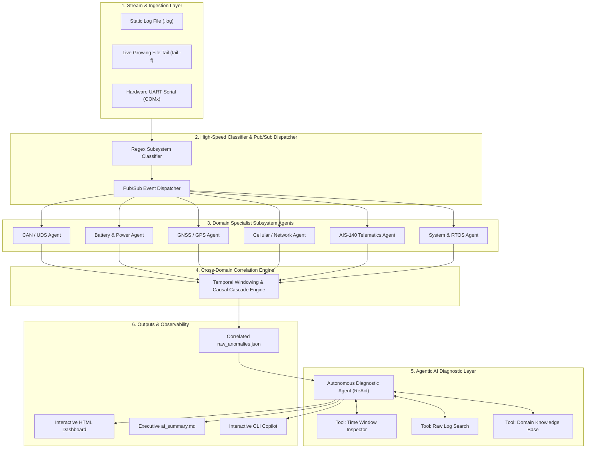

# 📘 Automotive Telematics & Embedded Firmware Knowledge Base

## 1. System Architecture & Multi-Domain Ingestion

The **LOG_ANALYZER** ingests high-volume telemetry traces from Automotive Telematics Control Units (TCUs), Vehicle Tracking Units (VTUs), and Electronic Control Units (ECUs). Telemetry data is parsed, classified, and analyzed across 6 core automotive subsystems:



---

## 2. Telemetry Syntax & Subsystem Specifications

The parser supports two industry-standard automotive embedded log formats:

### Format A: ATCU Snapshot NMEA-style Frames (`$TAG`)
Used during ECU bootup, periodic diagnostic heartbeats, and status queries:
- **GPS**: `$GPS,<msg_id>,<utc_time>,<fix_quality>,<latitude>,<longitude>,<sat_count>`
  - *Example*: `[2026-05-13 15:19:19.455] $GPS,1030,000000,0,0.000000,0.000000,0`
- **Battery**: `$ANALOG,<ext_batt>,<int_batt>,<tmpr>,<an1>,<an2>`
  - *Example*: `[2026-05-13 15:19:19.445] $ANALOG,23.98,3.76,25,0.00,23.94`
- **Cellular & MQTT**: `$GSM,<csq>,<creg>,<cgreg>,<tcp_skt>,<mqtt_count>,"<operator>",...`
  - *Example*: `[2026-05-13 15:19:19.455] $GSM,26,1,1,1,1,"Jio 4G",-,0,0`
- **CAN Bus**: `$CAN2,<bus_state>,<error_flag>`
  - *Example*: `[2026-05-13 15:19:19.471] $CAN2,0,0`

### Format B: Subsystem Execution Traces (`[PLA]`, `[CAN]`, `[AIS]`)
Generated dynamically during active firmware execution:
- **CAN / UDS**: `[CAN] UDS Session Timeout` | `DTC: 0xP0100`
- **Battery / Power**: `[PLA] ANALOG INT BATT 3.76V 55.58 PERCENT, TMPR 0, EXT BATT 23.98V, AN 0.00V`
- **GNSS / GPS**: `[PLA] GPS RX 322,DT 060180,TM 000841,LAT 0.000000,LONG 0.000000,FIX QUA 0,SAT 0`
- **Cellular / Network**: `[PLA] NET CSQ 26, CREG: 2, CGREG: 2, TCP SKT: 000, MQTT: 0, OPR NM:`
- **AIS-140**: `[AIS] Packet saved to history TxSeq=15 CTX=0 PktTyp=3` | `[AIS] PRI | EPB`
- **System / Power**: `[PLA] SLEEP 176...` | `[PLA] DIAG HEAP (5551624/12582912)` | `[PLA] DIGITAL IGN 0`

---

## 3. Subsystem Knowledge Rule Matrix & Anomaly IDs

| Subsystem | Anomaly ID | Condition | Severity | Root Cause & Diagnostic Remediation |
| :--- | :--- | :--- | :--- | :--- |
| **GPS** | `GPS_KN_001` | `SAT == 0 AND FIX == 0` | High | GNSS receiver lost satellite RF signals. Check antenna SMA connection, LNA supply rail (~3.3V), and sky visibility. |
| **GPS** | `GPS_KN_002` | `SAT >= 4 AND FIX == 0` | High | Satellites visible but 3D fix unacquired. Check GNSS ephemeris interval, HDOP dilution, and multipath reflections. |
| **GPS** | `GPS_KN_003` | `FIX == 1 AND (LAT==0 OR LONG==0)` | Medium | Zero coordinates reported with valid fix bit. Inspect NMEA parser buffer offset in firmware C-struct. |
| **GPS** | `GPS_KN_004` | `0 < SAT < 4` | Medium | Weak satellite reception (<4 satellites). Check sky visibility or vehicle underpass. |
| **BATTERY** | `BATT_KN_001` | `EXT_BATT < 9.0V` | High | Vehicle main battery disconnected or dropped below operational range. Inspect alternator and harness fuse. |
| **BATTERY** | `BATT_KN_002` | `INT_BATT < 3.4V OR SOC < 15%` | High | Internal backup Li-ion battery depleted. Inspect internal charger IC (e.g. BQ24xxx) or replace cell. |
| **BATTERY** | `BATT_KN_003` | `TMPR > 55°C` | High | Battery thermistor over-temperature. Verify enclosure heatsinking and thermal isolation from engine bay. |
| **BATTERY** | `BATT_KN_004` | `EXT_BATT < 7.5V (cranking)` | Medium | Engine starter cranking voltage sag. Ensure TCU meets ISO 16750-2 cold cranking pulse requirements. |
| **CAN** | `CAN_KN_001` | `UDS Session Timeout` | High | UDS diagnostic session timed out waiting for ECU response. Check ECU power state (IGN), CAN-H/L wiring, and termination. |
| **CAN** | `CAN_KN_002` | `DTC Code Active` | Critical | Diagnostic Trouble Code reported by vehicle ECU. Cross-reference code in OEM fault dictionary. |
| **CAN** | `CAN_KN_003` | `BUS_STATE == 2 (Bus-Off)` | Critical | CAN controller Tx Error Counter exceeded 255. Verify 60-ohm bus impedance and baud rate clock configuration. |
| **NET** | `NET_KN_001` | `CSQ < 10` | Medium | Poor cellular RF signal quality. Check LTE antenna placement and RF shielding. |
| **NET** | `NET_KN_002` | `CREG in [0, 2, 3]` | High | Mobile network registration failed or searching. Check SIM physical seating, APN, and carrier balance. |
| **NET** | `NET_KN_003` | `CGREG in [0, 2, 3]` | High | GPRS/LTE packet data unattached. Confirm APN profile and carrier PDP context activation. |
| **NET** | `NET_KN_004` | `MQTT == 0` | High | Telemetry MQTT broker disconnected. Check TLS certificate expiration, DNS resolution, and keepalive timer. |
| **AIS** | `AIS_KN_001` | `EMR == 1 OR PktTyp == 2` | Critical | Vehicle SOS emergency panic button triggered or rollover sensor active. Verify SOS wiring harness continuity. |
| **AIS** | `AIS_KN_002` | `Queue Backlog > 50` | High | Historical telematics buffer accumulating in flash without cloud acknowledgment. |
| **SYSTEM** | `SYS_KN_001` | `HEAP_RATIO > 0.90` | Critical | RTOS dynamic heap memory exhausted (>90%). Risk of kernel panic; profile firmware memory leaks. |
| **SYSTEM** | `SYS_KN_002` | `CPU_TEMP > 85°C` | High | MCU die temperature exceeded thermal threshold. Check PCB thermal vias and clock scaling. |
| **SYSTEM** | `SYS_KN_003` | `UPTIME Reset` | Critical | Unexpected MCU watchdog reboot while vehicle running. Inspect watchdog timeout register and 3.3V rail. |
| **SYSTEM** | `SYS_KN_004` | `IGN == 0 AND SLEEP > 0` | Low | Vehicle parked; TCU entered expected low-power standby sleep cycle to conserve battery. |

---

## 4. Cross-Domain Temporal Correlation & Causal Cascades

The analyzer includes an autonomous cross-domain correlation engine that links related anomalies across subsystems to distinguish primary root causes from secondary symptoms:

1. **Vehicle Sleep Cascade**: When vehicle ignition turns off (`IGN=0`, `SYS_KN_004`), CAN communications halt (`CAN_KN_001`) and GPS fixes are suspended (`GPS_KN_001`). The engine tags CAN and GPS events as `CASCADE_SYMPTOM`, preventing false-positive hardware failure alerts.
2. **RF Shielded Zone Cascade**: Concurrent cellular CSQ drops (`NET_KN_001`) and GPS satellite loss (`GPS_KN_001`) are correlated as `RF_SHIELDED_ZONE` (e.g. vehicle driving through a tunnel or underground garage).
3. **Firmware Crash Cascade**: RTOS heap memory depletion (`SYS_KN_001`) preceding an unexpected MCU uptime reset (`SYS_KN_003`) is identified as an OOM-induced watchdog reset.

---

## 5. Agentic AI Architecture & Diagnostic Tools

The Agentic AI diagnostic layer uses a ReAct (Reason + Act) loop with dedicated tools:
- **`tool_query_time_window(start_line, end_line, log_path)`**: Inspects raw telemetry surrounding an anomaly.
- **`tool_search_raw_logs(pattern, log_path)`**: On-demand regex grep across multi-gigabyte log traces.
- **`tool_query_knowledge_base(rule_id)`**: Retrieves engineering thresholds, failure modes, and QA tests.

### Interactive Automotive Diagnostic Copilot
Engineers can launch the conversational copilot to interrogate the log in real-time:
```bash
python main.py --copilot
```
*Example Copilot Queries:*
- *"Why did the CAN UDS session timeout at line 147?"*
- *"Was the vehicle battery voltage normal when the modem disconnected?"*
- *"Show all critical severity events and suggest firmware fixes."*
