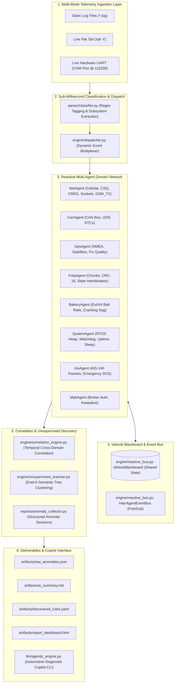
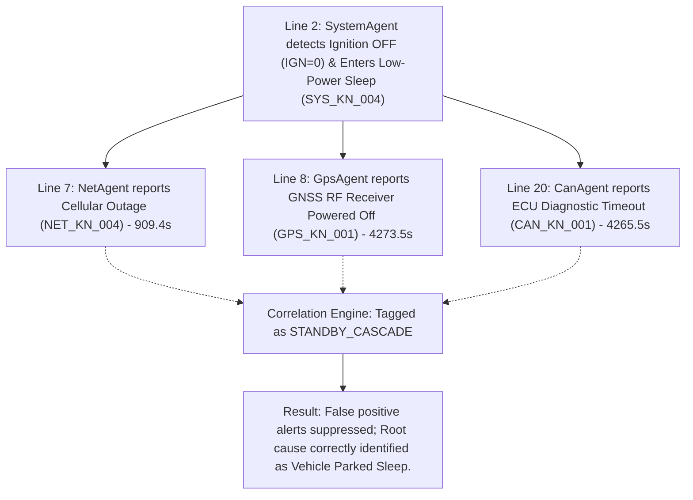
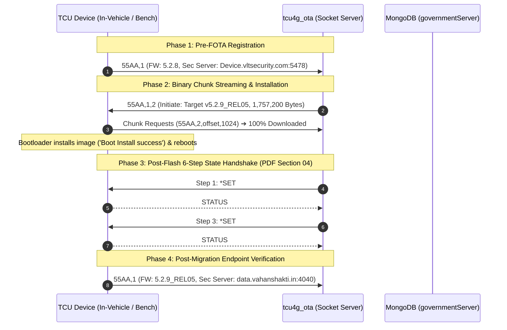

# Level 4 Autonomous Agentic AI Automotive Telemetry & Log Analyzer: System Architecture & Complete Working Guide

---

## 1. Executive Overview

The **Automotive Telemetry & Log Analyzer** is a **Level 4 Autonomous, Multi-Agent AI Diagnostic System** designed specifically for automotive embedded electronic control units (ECUs) and Telematics Control Units (TCUs, such as TCU4G / TCU2G, complying with India AIS-140, EU eCall, and global telematics standards).

Automotive telematics logs are multi-gigabyte, multi-threaded, asynchronous streams capturing simultaneous events across cellular modems, GNSS receivers, CAN bus transceivers, power management ICs, RTOS kernels, and remote firmware flashing engines. 

This project solves three fundamental automotive diagnostic challenges:
1. **Separating Primary Root Causes from Secondary Standby Cascades:** In conventional log viewers, when a vehicle enters low-power sleep (`IGN=0`), widespread false alarms occur (CAN timeouts, GPS loss, MQTT drops). This system uses an interdependent reactive multi-agent bus to automatically recognize expected power-down cascades and suppress false positives.
2. **Level 4 Unsupervised Semantic Discovery:** Beyond static regex rules, the system employs semantic log tree mining (Drain3) to uncover unmodeled zero-shot hardware and driver faults (`XL_ERRNO` accelerometer bus faults, modem `+CME ERROR`, buffer drops) and synthesize adaptive rule proposals on the fly.
3. **Real-Time Interactive Diagnostic Copilot:** A Gemini-powered, tool-grounded conversational agent capable of interrogating live UART serial feeds, actively tailing growing files (`tail -f`), verifying Indian State AIS-140 FOTA migrations, and dynamically synthesizing missing telemetry fields (e.g., `CIP1`) on the fly.

---

## 2. End-to-End System Architecture

The system operates as an event-driven, reactive pipeline:



---

## 3. Telemetry Ingestion Modes

The analyzer provides three distinct operational modes in [`main.py`](file:///D:/AEPL_AUTOMATION/LOG_ANALYZER/main.py):

| Ingestion Mode | CLI Command | Implementation File | Operational Context |
| :--- | :--- | :--- | :--- |
| **Static File Mode** | `python main.py --mode file --log-file <path>` | [`parser/gps_log_reader.py`](file:///D:/AEPL_AUTOMATION/LOG_ANALYZER/parser/gps_log_reader.py) | Comprehensive post-mortem analysis of archived test tracks, field failure dumps, and engineering bench logs. |
| **Live Tail Mode** | `python main.py --mode tail --log-file <path> --copilot` | [`parser/live_stream_reader.py`](file:///D:/AEPL_AUTOMATION/LOG_ANALYZER/parser/live_stream_reader.py) | Monitors an actively growing file (`tail -f`). Runs ingestion in a background daemon thread while presenting the interactive Copilot in the foreground. |
| **Live UART Mode** | `python main.py --mode uart --port COM3 --baud 115200 --copilot` | [`parser/live_stream_reader.py`](file:///D:/AEPL_AUTOMATION/LOG_ANALYZER/parser/live_stream_reader.py) | Directly connects to the physical TCU's serial debug port via PySerial for live bench and vehicle road trials. |

---

## 4. Multi-Agent Reactive Domain Subsystems

Each subsystem is monitored by an autonomous agent inheriting from [`BaseAgent`](file:///D:/AEPL_AUTOMATION/LOG_ANALYZER/agents/base_agent.py). Domain agents communicate asynchronously over the **Inter-Agent Event Bus** and read/write the shared **Vehicle Blackboard**:

```text
                                  +-----------------------+
                                  |   VehicleBlackboard   |
                                  | - Ignition State      |
                                  | - Battery Voltages    |
                                  | - CSQ / CREG / SKT    |
                                  | - GPS Fix & Sats      |
                                  | - Device Identity     |
                                  | - Inferred Parameters |
                                  +-----------+-----------+
                                              ^
                                              | (Reads & Writes)
                      +-----------------------+-----------------------+
                      |                       |                       |
               +------+------+         +------+------+         +------+------+
               |  NetAgent   | <=====> |  CanAgent   | <=====> |  GpsAgent   |
               +------+------+         +------+------+         +------+------+
                      ^                       ^                       ^
                      |                       |                       |
                      |            Inter-Agent Event Bus              |
                      |            (Pub/Sub Message Passing)          |
                      v                       v                       v
               +------+------+         +------+------+         +------+------+
               |  FotaAgent  | <=====> | BatteryAgent| <=====> | SystemAgent |
               +-------------+         +-------------+         +-------------+
```

### 4.1 Subsystem Specifications

#### 1. [`NetAgent`](file:///D:/AEPL_AUTOMATION/LOG_ANALYZER/agents/net_agent.py) (Network & Cellular Modem)
* **Monitored Parameters:** `CSQ` (RF Signal Quality, 0–31), `CREG` (Network Registration), `CGREG` (GPRS/LTE Packet Data Attach), `MQTT` (Cloud Broker Uptime), `TCP SKT` (Socket Bitmask).
* **Socket Bitmask Architecture:** `TCP SKT [Bit2 Bit1 Bit0]` -> `[AIS CHTP CIP1]`
  - `Bit 2 (AIS)`: Primary AIS-140 government regulatory emergency tracking socket (`data.vahanshakti.in:4030`).
  - `Bit 1 (CHTP)`: Commercial fleet management HTTP/TCP socket.
  - `Bit 0 (CIP1)`: Customer IP 1 / Secondary auxiliary telemetry socket (`data.vahanshakti.in:4040`).
* **Format C Telematics Packet (`[NET] GSM_TX: |55AA,1,...|`):** Parses the 39-field login registration packet containing Device IMEI, SIM ICCID, Vehicle VIN, Firmware Version, Hardware Model, Primary/Secondary Servers, Analog Calibrations, GPS fix, and Internal/External battery voltages.
* **On-the-Go Synthesis:** Detects missing or unset `CIP1` bits and dynamically imputes active status when secondary endpoints and Socket 2 modem traffic are detected.

#### 2. [`CanAgent`](file:///D:/AEPL_AUTOMATION/LOG_ANALYZER/agents/can_agent.py) (Controller Area Network & Diagnostics)
* **Monitored Parameters:** CAN Bus Controller State (0=Active, 1=Passive, 2=Bus-Off), UDS Diagnostic Sessions (ISO 14229), Diagnostic Trouble Codes (SAE J2012 / DTCs like `0x900101`, `0x900300`, `0x900800`).
* **Standby Collaboration:** Subscribes to `SYSTEM_SLEEP_ENTER` and `IGNITION_CHANGED (IGN=0)`. Automatically re-classifies CAN timeouts during vehicle sleep as expected standby cascades, suppressing false hardware alarms.

#### 3. [`GpsAgent`](file:///D:/AEPL_AUTOMATION/LOG_ANALYZER/agents/gps_agent.py) (GNSS / Satellite Navigation)
* **Monitored Parameters:** NMEA sentences (`$GPRMC`, `$GPGGA`), Fix Quality (0=Invalid, 1=3D GPS, 2=DGPS), Satellites tracked (`SAT`), HDOP, coordinates latitude/longitude.
* **RF Power Collaboration:** Automatically correlates satellite drops during vehicle sleep with planned GNSS low-power shutoff to protect the vehicle battery.

#### 4. [`FotaAgent`](file:///D:/AEPL_AUTOMATION/LOG_ANALYZER/agents/fota_agent.py) (Firmware Over-The-Air & Configuration)
* **Monitored Parameters:** FOTA task state machine, 1024-byte chunk streaming, CRC-16/XMODEM verification, eMMC flash write offsets, download progress %, resume interruptions.
* **State Handshake Tracking:** Parses remote OTA requests (`*SET#SWEMP#<STATE>#`, `*SET#CIP1#<ip>#<port>#`, `*SET#CHTP#...`) and device acknowledgments (`STATUS#SET#...#OK`) as specified in [`FOTA-Workflow.pdf`](file:///D:/AEPL_AUTOMATION/LOG_ANALYZER/FOTA-Workflow.pdf).

#### 5. [`BatteryAgent`](file:///D:/AEPL_AUTOMATION/LOG_ANALYZER/agents/battery_agent.py) (Power Management & Energy Storage)
* **Monitored Parameters:** External Vehicle Battery Voltage (`EXT_BATT`, 12V/24V nominal, brownout threshold < 9.0V, low threshold < 11.5V, cold cranking sag < 7.5V), Internal Backup Li-ion Battery (`INT_BATT` < 3.4V, SOC < 15%), Battery Pack Thermistor Temperature (`TMPR` > 55°C).

#### 6. [`SystemAgent`](file:///D:/AEPL_AUTOMATION/LOG_ANALYZER/agents/system_agent.py) (RTOS Kernel & Vehicle Power State)
* **Monitored Parameters:** RTOS Dynamic Heap Memory Ratio (`HEAP_RATIO` > 0.90), MCU Die Temperature (`CPU_TEMP` > 85°C), MCU Uptime Resets (Watchdog resets), Ignition Discrete Line (`IGN=0` vs `IGN=1`), Vehicle Low-Power Sleep state timer.

#### 7. [`AisAgent`](file:///D:/AEPL_AUTOMATION/LOG_ANALYZER/agents/ais_agent.py) (AIS-140 Government Regulatory Tracking)
* **Monitored Parameters:** Emergency SOS panic button presses (`EMR=1`), packet type triggers, flash memory transmission queue backlog (> 50 frames unacknowledged by cloud).

#### 8. [`MqttAgent`](file:///D:/AEPL_AUTOMATION/LOG_ANALYZER/agents/mqtt_agent.py) (Cloud Telemetry Broker)
* **Monitored Parameters:** MQTT broker authentication, TLS handshake, keepalive heartbeat, network disconnect cascades.

---

## 5. Cross-Domain Temporal Correlation & Standby Cascades

Automotive components do not fail in isolation. The [`CorrelationEngine`](file:///D:/AEPL_AUTOMATION/LOG_ANALYZER/engine/correlation_engine.py) performs automated temporal clustering across subsystem boundaries:



1. **Vehicle Sleep Cascade (`STANDBY_CASCADE`):** When the engine is turned off (`IGN=0`), CAN bus lines go quiet and the TCU powers down RF LNAs to conserve battery. The correlation engine marks secondary CAN, GPS, and Net drops as cascades of `SYS_KN_004`, reducing alert fatigue for test engineers.
2. **RF Shielded Zone Cascade (`RF_SHIELDED_ZONE`):** Concurrent cellular CSQ drops (`NET_KN_001`) and GPS satellite loss (`GPS_KN_001`) while the vehicle is driving (`IGN=1`) are flagged as tunnel / basement parking traversal.
3. **OOM Kernel Panic Cascade:** Dynamic heap memory exhaustion (`SYS_KN_001`) immediately followed by an MCU uptime reset (`SYS_KN_003`) is identified as an out-of-memory watchdog reboot.

---

## 6. Level 4 Unsupervised Semantic Discovery

Pre-configured rules cannot capture every possible embedded error string. The [`UnsupervisedScanner`](file:///D:/AEPL_AUTOMATION/LOG_ANALYZER/engine/unsupervised_scanner.py) provides zero-shot anomaly discovery:

1. **Line Filtering:** Strips normal operational chatter, timestamps, and lines already recognized by existing regex agents.
2. **Drain3 Semantic Parse-Tree Clustering:** Parses raw text lines into dynamic structural templates with variable masks (e.g., `ACCEL: XL_ERRNO <*>`, `+CME ERROR: <*>`).
3. **Adaptive Rule Formulation:** When recurring fault clusters are identified, the system automatically writes proposed rules into [`artifacts/discovered_rules.yaml`](file:///D:/AEPL_AUTOMATION/LOG_ANALYZER/artifacts/discovered_rules.yaml) with condition, severity, root cause, and suggested firmware fix.

---

## 7. Indian State Government AIS-140 FOTA & IP/Port Migration

The system implements complete architectural validation of the multi-state FOTA workflow described in [`FOTA-Workflow.pdf`](file:///D:/AEPL_AUTOMATION/LOG_ANALYZER/FOTA-Workflow.pdf):



### 7.1 Verified Ground-Truth Evidence in [`FOTA_REL_18_861564061380138_To_REL_05.log`](file:///D:/AEPL_AUTOMATION/LOG_ANALYZER/logs/FOTA_REL_18_861564061380138_To_REL_05.log)
* **Pre-FOTA Baseline (Lines 1897 & 3713):** Device registered running firmware `5.2.8` with secondary endpoint `Device.vltsecurity.com:5478`.
* **Binary Transfer (Lines 3858–120504):** Downloaded 1,757,200 bytes (1.68 MB) in 1024-byte chunks with CRC-16/XMODEM verification.
* **State Handshake (Maharashtra State, Lines 122906–125364):**
  - Line 122919: `*SET#SWEMP#MH#` -> Acknowledged at Line 122922 with `STATUS#SET#SWEMP#MH#OK`
  - Line 125361: `*SET#CIP1#data.vahanshakti.in#4040#` -> Acknowledged at Line 125363 with `STATUS#SET#CIP1#data.vahanshakti.in#4040#OK`
* **Post-Migration Registration (Line 127658):** Device reconnected running upgraded firmware **`5.2.9_REL05`** with secondary server successfully migrated to **`data.vahanshakti.in:4040`**.

---

## 8. Dynamic On-the-Go Parameter Synthesis (e.g., Missing/Unset `CIP1`)

If a telemetry log frame has `CIP1` missing from the bitmask (e.g. older 2-bit string `TCP SKT: 01`) or reports `0` when secondary servers are provisioned, the Level 4 engine performs **Cross-Field Contextual Reconstruction**:
1. Checks `secondary_server` from the login packet (`data.vahanshakti.in:4040`).
2. Checks active firmware version (`5.2.9_REL05`).
3. Checks for modem Socket 2 transport traffic (`[NET] producer: 88, socket: 2`).
4. Automatically imputes:
   ```python
   blackboard.set_inferred_parameter(
       param_name="tcp_cip1",
       inferred_value=1,
       confidence=0.95,
       rationale="Synthesized CIP1=1 on the fly based on provisioned secondary server and Socket 2 events."
   )
   ```
5. Prevents downstream parser crashes and provides permanent hardware AT configuration commands:
   ```text
   AT+QIOPEN=1,2,"TCP","data.vahanshakti.in",4040,0,1
   AT$VLT_CFG_SET="CIP1_ENABLE",1
   ```

---

## 9. Automotive Telemetry Copilot & Diagnostic Tool Inventory

The interactive Copilot in [`llm/agentic_engine.py`](file:///D:/AEPL_AUTOMATION/LOG_ANALYZER/llm/agentic_engine.py) provides 12 specialized diagnostic tools:

| Tool Name | Purpose & Telemetry Grounding |
| :--- | :--- |
| **`validate_state_fota_migration`** | Validates Indian State FOTA campaigns, tracking pre-FOTA endpoints, post-flash `*SET#...` commands, and post-reboot IP/port migration. |
| **`audit_telemetry_configuration`** | Audits parameters (`CIP1`, `CHTP`, `AIS`), distinguishing raw telemetry from dynamically synthesized states. |
| **`inspect_login_handshakes`** | Summarizes all `55AA,1` device registration packets, device IMEI, ICCID, VIN, firmware versions, and server endpoints. |
| **`inspect_agent_collaborations`** | Visualizes reactive cross-agent dependency events (e.g. CAN standby cascades during sleep). |
| **`analyze_fota_download_progress`** | Computes FOTA download duration, starting/ending %, throughput (KB/s), chunk sizes, and resume interruptions. |
| **`analyze_fota_telemetry_environment`** | Analyzes CSQ signal strength, MQTT connectivity, Operator Name (OPR NM), and TCP SKT bitmask across FOTA phases. |
| **`search_log_pattern`** | Performs high-speed regex search across multi-gigabyte log traces. |
| **`inspect_log_window`** | Retrieves formatted raw log context around a specific line number. |
| **`get_subsystem_telemetry_at_line`** | Extracts synchronous multi-subsystem telemetry values at any line in the log. |
| **`query_dtc_database`** | Cross-references automotive DTCs in the SAE J2012 / ISO 14229 dictionary. |
| **`query_knowledge_base`** | Queries automotive failure thresholds, physical root causes, and bench test procedures. |
| **`propose_adaptive_rule`** | Formulates novel discovered log patterns into permanent YAML rules. |

---

## 10. Generated Artifacts & Deliverables

Every analysis run produces four comprehensive deliverables:
1. **[`artifacts/raw_anomalies.json`](file:///D:/AEPL_AUTOMATION/LOG_ANALYZER/artifacts/raw_anomalies.json):** Full structured database of every anomaly event, line numbers, durations, sensor values, and cross-domain causal dependencies.
2. **[`artifacts/ai_summary.md`](file:///D:/AEPL_AUTOMATION/LOG_ANALYZER/artifacts/ai_summary.md):** Executive-level diagnostic engineering report synthesizing pass/fail health, primary root causes vs standby cascades, and step-by-step firmware fixes.
3. **[`artifacts/discovered_rules.yaml`](file:///D:/AEPL_AUTOMATION/LOG_ANALYZER/artifacts/discovered_rules.yaml):** Self-adapted rule definitions formulated from unsupervised semantic log discovery.
4. **[`artifacts/report_dashboard.html`](file:///D:/AEPL_AUTOMATION/LOG_ANALYZER/artifacts/report_dashboard.html):** Modern interactive web dashboard with anomaly timelines, subsystem breakdown charts, and diagnostic drill-downs.

---

## 11. Command Line Interface (CLI) Cheat Sheet

```powershell
# 1. Standard Static Log Analysis with HTML Dashboard and Summary:
python main.py --mode file --log-file logs/FOTA_REL_18_861564061380138_To_REL_05.log

# 2. Static Analysis followed by Interactive Copilot REPL:
python main.py --mode file --log-file logs/FOTA_REL_18_861564061380138_To_REL_05.log --copilot

# 3. Live File Tailing with Concurrent Real-Time Copilot:
python main.py --mode tail --log-file logs/FOTA_REL_18_861564061380138_To_REL_05.log --copilot

# 4. Live Hardware UART Serial Streaming directly from TCU COM Port:
python main.py --mode uart --port COM3 --baud 115200 --copilot
```

### Example Copilot Queries:
* *"Validate state fota migration and verify if the state ip and port changed"*
* *"What is the login packet and how many times was it sent?"*
* *"What is the CSQ, MQTT, and socket status during FOTA downloading?"*
* *"How much time was required to download the FOTA?"*
* *"Audit CIP1 configuration and check if it was set on the go"*
* *"How do the reactive agents work together during sleep mode?"*
