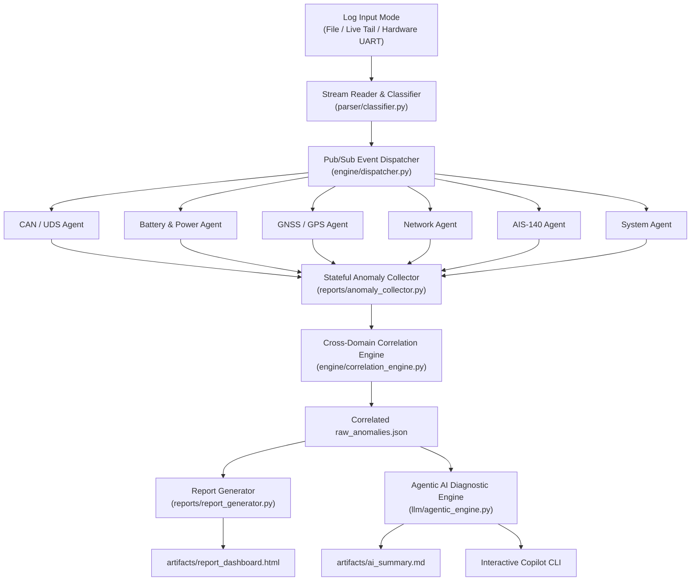

# 🚀 Agentic AI Automotive Telemetry & Firmware Log Analyzer

> **Autonomous Multi-Domain Telemetry Log Analysis, Stateful Event Resolution, Cross-Subsystem Fault Correlation & Agentic AI Root Cause Synthesis for Automotive & IoT Embedded Systems.**

---

## 📌 Overview

**LOG_ANALYZER** is a high-performance Python application engineered for Automotive QA engineers, TCU firmware developers, and vehicle validation teams. It processes raw telemetry traces from Telematics Control Units (TCUs), Electronic Control Units (ECUs), and vehicle tracking hardware.

It ingests multi-gigabyte log files or real-time UART serial streams, classifies log events across 6 domain subsystems (**CAN / UDS**, **Battery & Power**, **GNSS / GPS**, **Cellular & MQTT**, **AIS-140 Telematics**, **System & RTOS**), tracks stateful outage lifecycles, performs cross-domain temporal causal correlation, and synthesizes executive diagnostic reports via an autonomous Agentic AI layer.

---

## 🌟 Key Features

- **⚡ Fast Stream Ingestion**: High-throughput non-blocking line streaming processing **200,000+ line log files in seconds**.
- **🔄 Stateful Outage Session Engine**: Tracks anomaly lifecycles from fault trigger to recovery (e.g. Line 8 → Line 147182) and calculates precise outage durations (seconds).
- **🏎️ 6 Automotive Subsystem Agents**:
  1. **CAN / UDS Diagnostics**: ISO 14229 UDS timeouts, CAN error passive/bus-off, active DTC fault codes.
  2. **Battery & Vehicle Power**: 12V/24V external vehicle battery rails, cranking voltage sag, internal backup Li-ion SoC, and thermal monitoring.
  3. **GNSS / Positioning**: NMEA/ATCU parsing, cold-boot lock timeouts, satellite count thresholds, zero coordinates.
  4. **Cellular Network & MQTT**: CSQ RF quality, CREG network registration, CGREG packet attach, and cloud MQTT telemetry sockets.
  5. **AIS-140 Telematics**: Indian government automotive ITS emergency SOS states, packet transmission sequence tracking, flash queue backlog.
  6. **System RTOS & Sleep**: FreeRTOS heap memory depletion, MCU junction temperature, watchdog reboots, vehicle ignition state, and low-power standby cycles.
- **🔗 Cross-Domain Temporal Correlation Engine**: Differentiates primary root causes from secondary symptoms (e.g., identifies that CAN timeouts and GPS fix suspensions were caused by the vehicle entering low-power sleep mode after ignition shutoff).
- **🧠 Agentic AI Diagnostic Layer**: Autonomous ReAct agent with diagnostic inspection tools to investigate log windows, verify hypotheses, and generate executive root cause reports via Google Gemini API (with offline expert fallback).
- **🤖 Interactive Automotive Copilot (`--copilot`)**: Conversational CLI allowing test engineers to interrogate the log, ask questions in natural language, and receive cited answers with line references.
- **📊 Interactive HTML Dashboard**: Visual dark-mode dashboard with KPI metrics, subsystem filters, search controls, and raw fault/recovery traces.

---

## 📐 Architecture & Data Flow



---

## 🛠️ Installation & Setup

### 1. Prerequisites
- **Python 3.10+** installed on system.

### 2. Install Dependencies
```bash
pip install -r requirements.txt
```

### 3. Configure Environment Variables
Inside `.env`:
```env
GEMINI_API_KEY=your_gemini_api_key_here
```
*(If no API key is provided, the AI layer automatically generates local structured root cause synthesis reports).*

---

## 🚀 Usage Guide

### 1. Static File Mode (Default)
Analyze an automotive log file:
```bash
python main.py --log-file logs/FOTA_REL_18_861564061380138_To_REL_05.log
```

### 2. Interactive Copilot Mode (`--copilot`)
Launch the conversational AI Copilot to ask questions about the analyzed log:
```bash
python main.py --log-file logs/FOTA_REL_18_861564061380138_To_REL_05.log --copilot
```
*Example Questions:*
- *"Why did the CAN UDS session timeout occur?"*
- *"Was the battery voltage normal when the modem lost registration?"*
- *"Show all critical severity events and suggest firmware fixes."*

### 3. Live Growing File Tailing Mode (`tail -f`)
Tail a growing log file dynamically during active bench testing:
```bash
python main.py --mode tail --log-file logs/live_telemetry.log
```

### 4. Hardware UART Serial Port Streaming Mode
Connect directly to ECU debug hardware over USB-to-UART serial interface:
```bash
python main.py --mode uart --port COM3 --baud 115200
```

---

## 📁 Output Deliverables (`artifacts/`)

All generated deliverables are stored in the [`artifacts/`](file:///D:/AEPL_AUTOMATION/LOG_ANALYZER/artifacts) directory:

- **[`artifacts/raw_anomalies.json`](file:///D:/AEPL_AUTOMATION/LOG_ANALYZER/artifacts/raw_anomalies.json)**: Correlated JSON dataset of all detected anomaly events across all 6 subsystems with line metadata, outage duration metrics, and causal dependency tags.
- **[`artifacts/report_dashboard.html`](file:///D:/AEPL_AUTOMATION/LOG_ANALYZER/artifacts/report_dashboard.html)**: Interactive visual HTML dashboard with KPI summary, subsystem filter buttons, search bar, and raw fault traces.
- **[`artifacts/ai_summary.md`](file:///D:/AEPL_AUTOMATION/LOG_ANALYZER/artifacts/ai_summary.md)**: Agentic AI root cause synthesis, cross-domain cascade analysis, and QA remediation roadmap.

---

## 📖 Knowledge Base Documentation

For technical specifications, NMEA/ATCU telemetry command schemas, anomaly rule IDs (`CAN_KN_001`, `BATT_KN_001`, `GPS_KN_001`, etc.), and parameter threshold tables, consult [`KNOWLEDGE_BASE.md`](file:///D:/AEPL_AUTOMATION/LOG_ANALYZER/KNOWLEDGE_BASE.md).

---

## 📂 Project Directory Structure

```
LOG_ANALYZER/
├── agents/                 # Subsystem Domain Agents
│   ├── base_agent.py       # Stateful Session Lifecycle Manager
│   ├── battery_agent.py    # 12V/24V Vehicle & Internal Li-ion Battery Agent
│   ├── can_agent.py        # ISO 14229 UDS & CAN Bus Diagnostic Agent
│   ├── gps_agent.py        # GNSS Positioning & NMEA Telemetry Agent
│   ├── net_agent.py        # Cellular CSQ, CREG/CGREG & MQTT Agent
│   ├── ais_agent.py        # AIS-140 ITS Emergency Telematics Agent
│   └── system_agent.py     # RTOS Heap, CPU Temp, Watchdog & Sleep Agent
├── engine/                 # Processing & Correlation Engine
│   ├── dispatcher.py       # Pub/Sub Subsystem Event Dispatcher
│   └── correlation_engine.py # Cross-Domain Causal Cascade Engine
├── parser/                 # Stream Parsers & Classifiers
│   ├── classifier.py       # Multi-Domain Subsystem Regex Classifier
│   ├── gps_log_reader.py   # High-Throughput Stream Reader
│   └── live_stream_reader.py # Live Tailing & UART Serial Reader
├── reports/                # Report Generators & Collector
│   ├── anomaly_collector.py # Anomaly Collector & Normalizer
│   └── report_generator.py # Interactive HTML Dashboard Generator
├── llm/                    # Agentic AI Synthesis Layer
│   ├── agentic_engine.py   # Autonomous ReAct Diagnostic Agent & Copilot
│   └── summary_agent.py    # AI Summary Wrapper
├── knowledge/              # Subsystem YAML Parameter Rules & Thresholds
│   ├── battery/parameters.yaml
│   ├── can/parameters.yaml
│   ├── gps/parameters.yaml
│   ├── net/parameters.yaml
│   ├── ais/parameters.yaml
│   └── system/parameters.yaml
├── artifacts/              # Output Deliverables (JSON, HTML & Markdown)
├── logs/                   # Raw Automotive Log Files
├── config.yaml             # Global Runtime Configuration
├── config_loader.py        # Configuration Loader
├── KNOWLEDGE_BASE.md       # Comprehensive Domain Knowledge Base
├── README.md               # Project Documentation
└── main.py                 # Application Entry Point & CLI
```
---

## Live Telemetry Streaming & Concurrent Copilot Modes

Run live log file tailing with concurrent interactive Copilot:
```powershell
python main.py --mode tail --log-file logs/FOTA_REL_18_861564061380138_To_REL_05.log --copilot
```

Run live hardware UART serial stream directly from TCU COM port:
```powershell
python main.py --mode uart --port COM3 --baud 115200 --copilot
```