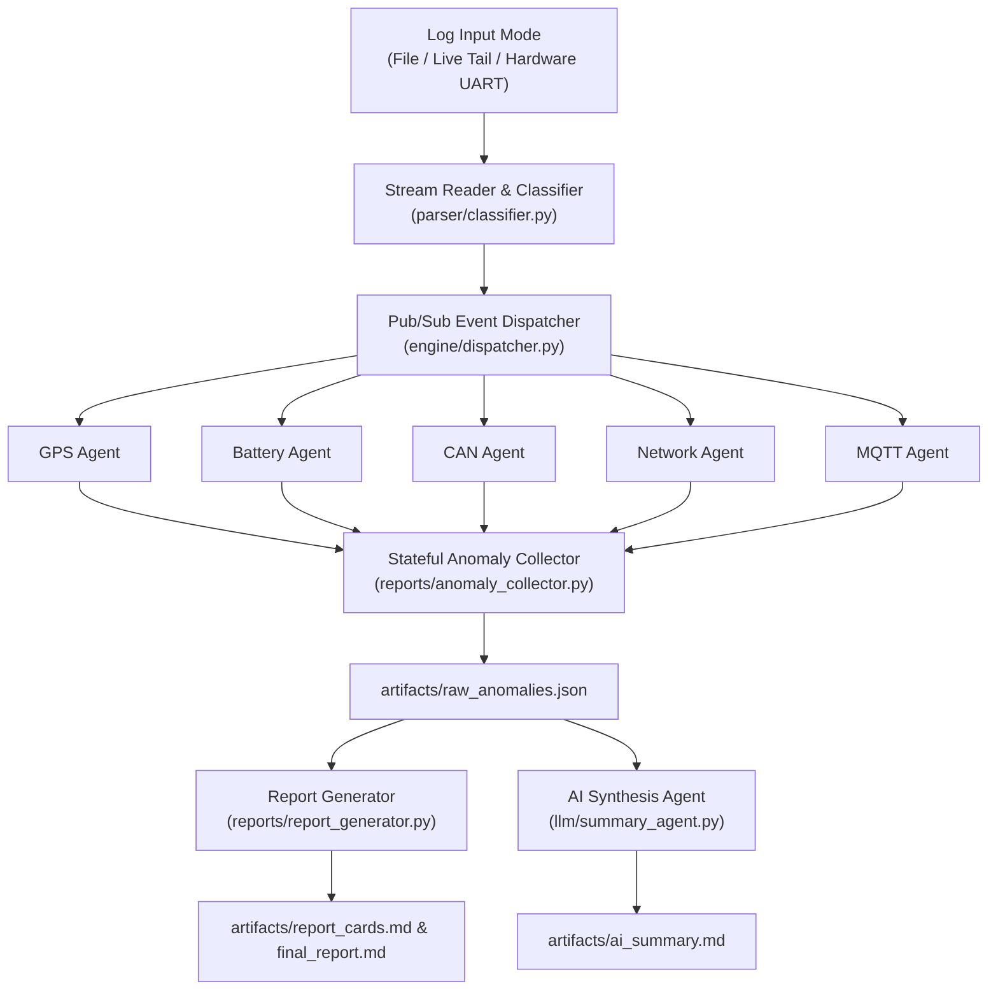

# 🚀 Telemetry & Firmware Log Analyzer

> **Automated Multi-Domain Telemetry Log Analysis, Stateful Event Resolution & Generative AI Root Cause Synthesis for Automotive & IoT Embedded Systems.**

---

## 📌 Overview

**LOG_ANALYZER** is a high-performance Python application engineered for QA engineers, firmware developers, and field validation teams. It processes raw telemetry traces from Telematics Control Units (TCUs), EV ECUs, and tracking devices.

It ingests multi-gigabyte log files or real-time UART serial streams, classifies log events across 5 domain subsystems (**GPS**, **BATTERY**, **CAN Bus**, **Cellular Network**, **MQTT**), evaluates parameters against domain knowledge bases, tracks stateful anomaly durations, and synthesizes executive AI root cause reports.

---

## 🌟 Key Features

- **⚡ Fast Stream Ingestion**: Processes **200,000+ line log files in < 3 seconds** without memory overhead.
- **🔄 Stateful Session Engine**: Tracks anomaly lifecycles from start line to recovery line (e.g. Line 2 → Line 40) and calculates outage duration (seconds).
- **📡 Multi-Mode Operations**:
  1. **Static File Mode**: Batch processing of stored `.log` files.
  2. **Live Tail Mode (`tail -f`)**: Real-time non-blocking file tailing for growing log files.
  3. **Hardware UART Serial Mode**: Real-time direct ingestion from device debug ports via `pyserial`.
- **⚙️ Highly Configurable**: All directory paths, UART defaults, AI model endpoints, and parsing thresholds are managed via [`config.yaml`](file:///d:/AEPL_AUTOMATION/LOG_ANALYZER/config.yaml).
- **🧠 Generative AI Root Cause Analysis**: Leverages Google Gemini 2.5 Flash API (with offline fallback) to synthesize executive root cause diagnoses and remediation roadmaps.
- **📊 Multidimensional Deliverables**: Generates structured JSON datasets and Markdown executive reports in the [`artifacts/`](file:///d:/AEPL_AUTOMATION/LOG_ANALYZER/artifacts) folder.

---

## 📐 Architecture & Data Flow



---

## 🛠️ Installation & Setup

### 1. Prerequisites
- **Python 3.10+** installed on system.

### 2. Install Dependencies
```bash
pip install -r requirements.txt
```

### 3. Configure Environment Variables
Copy `.env.example` to `.env` and set your optional Gemini API Key:
```bash
cp .env.example .env
```
Inside `.env`:
```env
GEMINI_API_KEY=your_gemini_api_key_here
```
*(If no API key is provided, the AI layer automatically generates local structured root cause synthesis reports).*

---

## 🚀 Usage Guide

### 1. Static File Mode (Default)
Analyze a static log file (e.g. FOTA update log or drive-test log):
```bash
python main.py --log-file logs/REL18_TO_REL24.log
```

### 2. Live Growing File Tailing Mode (`tail -f`)
Tail a growing log file dynamically updated during active testing:
```bash
python main.py --mode tail --log-file logs/live_telemetry.log
```

### 3. Hardware UART Serial Port Streaming Mode
Connect directly to ECU debug hardware over USB-to-UART serial interface:
```bash
python main.py --mode uart --port COM3 --baud 115200
```

### View All Command Options
```bash
python main.py --help
```

---

## ⚙️ Configuration Guide (`config.yaml`)

Global runtime behavior can be customized in [`config.yaml`](file:///d:/AEPL_AUTOMATION/LOG_ANALYZER/config.yaml):

```yaml
paths:
  log_dir: "logs"
  artifact_dir: "artifacts"
  default_log_file: "logs/REL18_TO_REL24.log"
  raw_anomalies_json: "artifacts/raw_anomalies.json"
  report_cards_md: "artifacts/report_cards.md"
  final_report_md: "artifacts/final_report.md"
  ai_summary_md: "artifacts/ai_summary.md"

uart:
  default_port: "COM3"
  default_baudrate: 115200
  timeout: 1.0

live_tail:
  poll_interval: 0.1
  stop_on_idle_sec: 5.0

ai:
  model: "gemini-2.5-flash"
  api_url: "https://generativelanguage.googleapis.com/v1beta/models/gemini-2.5-flash:generateContent"
```

---

## 📁 Output Deliverables (`artifacts/`)

All generated deliverables are stored in the [`artifacts/`](file:///d:/AEPL_AUTOMATION/LOG_ANALYZER/artifacts) directory:

- **[`artifacts/raw_anomalies.json`](file:///d:/AEPL_AUTOMATION/LOG_ANALYZER/artifacts/raw_anomalies.json)**: Normalized JSON dataset of all detected anomaly events with line metadata and duration metrics.
- **[`artifacts/report_cards.md`](file:///d:/AEPL_AUTOMATION/LOG_ANALYZER/artifacts/report_cards.md)**: Individual anomaly cards with raw log evidence and suggested fixes.
- **[`artifacts/final_report.md`](file:///d:/AEPL_AUTOMATION/LOG_ANALYZER/artifacts/final_report.md)**: Executive report containing severity breakdown, source distribution, line ranges, and outage durations.
- **[`artifacts/ai_summary.md`](file:///d:/AEPL_AUTOMATION/LOG_ANALYZER/artifacts/ai_summary.md)**: Predictive root cause analysis and recommended action roadmap.

---

## 📖 Knowledge Base Documentation

For complete technical specifications, NMEA/ATCU telemetry command schemas, anomaly rule IDs (`GPS_KN_001`, `BATT_KN_001`, etc.), and parameter threshold tables, consult the [`KNOWLEDGE_BASE.md`](file:///d:/AEPL_AUTOMATION/LOG_ANALYZER/KNOWLEDGE_BASE.md) file.

---

## 📂 Project Directory Structure

```
LOG_ANALYZER/
├── agents/                 # Subsystem Domain Agents (GPS, Battery, CAN, Net, MQTT)
│   ├── base_agent.py       # Stateful Session Lifecycle Manager
│   ├── battery_agent.py    # Battery Telemetry Rules
│   ├── can_agent.py        # CAN Bus & UDS Rules
│   ├── gps_agent.py        # GPS Telemetry Rules
│   ├── mqtt_agent.py       # MQTT Telemetry Rules
│   └── net_agent.py        # Cellular Network Rules
├── engine/                 # Event Dispatcher Engine
│   └── dispatcher.py
├── parser/                 # Stream Parsers & Classifiers
│   ├── classifier.py       # Regex Classifier
│   ├── gps_log_reader.py   # Static Line Reader
│   └── live_stream_reader.py # Live Tailing & UART Serial Reader
├── reports/                # Report Generators & Collector
│   ├── anomaly_collector.py
│   └── report_generator.py
├── llm/                    # Generative AI Synthesis Layer
│   └── summary_agent.py
├── knowledge/              # YAML Parameter Rules & Thresholds
│   ├── gps/
│   ├── battery/
│   ├── can/
│   └── mqtt/
├── artifacts/              # Output Deliverables (JSON & Markdown)
├── logs/                   # Raw Sample Input Log Files
├── config.yaml             # Global YAML Configuration File
├── config_loader.py        # Configuration Loader Module
├── KNOWLEDGE_BASE.md       # Comprehensive Domain Knowledge Base
├── README.md               # Project Documentation
├── .env.example            # Environment Variable Template
└── main.py                 # Application Entry Point & CLI
```
